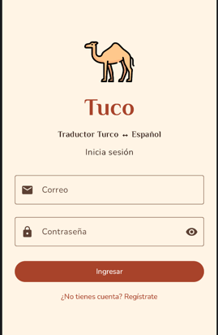

# Traductor Turco ↔ Español:
# "Tuco"

Tuco es una aplicación móvil Android sencilla, que traduce entre idiomas turco y español.

## Integrante
Rahyzza Novoa Vasquinzay

## Asignatura
DSY1105 - Desarrollo de Aplicaciones Móviles

## Contexto
Frente a la problemática de la comunicación frente al auge del intercambio comercial entre Turquía y Chile, se implementa una aplicación que permite escribir o dictar por voz, y guarda un historial de traducciones con favoritos.

## Funcionalidades
- Registro e inicio de sesión con validaciones visuales por campo
- Traducción turco ↔ español con ML Kit (funciona sin internet tras descargar el modelo)
- Dictado por voz con el micrófono (permiso en tiempo de ejecución)
- Retroalimentación háptica con vibración
- Historial de traducciones con favoritos y eliminación (persistencia local con Room)
- Animaciones de retroalimentación en formularios y botones

## Reglas de Negocio
- No pueden haber campos vacíos para el registro
- Correo único y válido
- Clave de mínimo 6 caracteres con un número
- Máximo 500 caracteres por traducción
- La traducción se guarda automáticamente

## Tecnologías
- Kotlin 
- Jetpack Compose 
- Material 3
- MVVM 
- Room 
- KSP
- ML Kit Translate 
- Navigation Compose

## Estructura
- `data/`: Room (entidades, DAOs) y repositorio
- `domain/`: validaciones y motor de traducción
- `native/`: recursos nativos (micrófono y vibración)
- `ui/`: pantallas, ViewModels y navegación

## Cómo ejecutar
1. Clonar el repositorio: `git clone https://github.com/RayFullstack/App_TraductorTurco.git`
2. Abrir la carpeta en Android Studio y sincronizar Gradle
3. Ejecutar en un emulador o dispositivo con Android 8.0 (API 26) o superior
4. La primera traducción requiere internet para descargar el modelo

## Planificación
Tablero Trello: https://trello.com/b/rmLgjb0e/app-tuco

## Capturas

