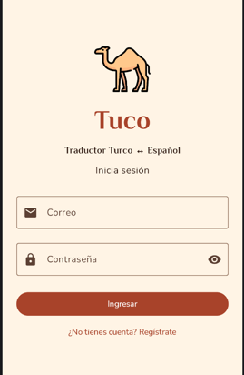
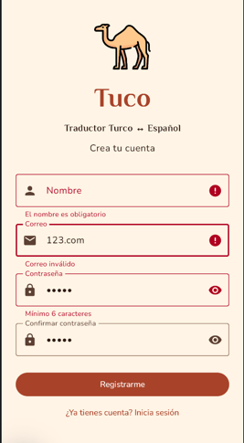
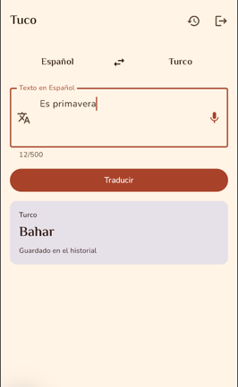
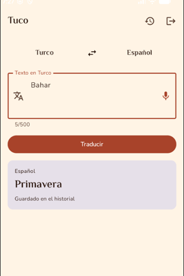
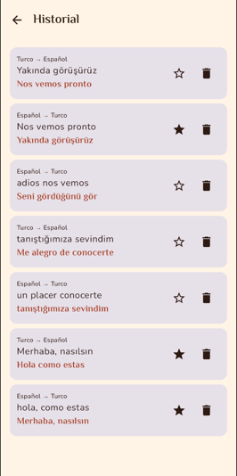

# Traductor Turco ↔ Español: "Tuco"

Tuco es una aplicación móvil Android nativa desarrollada en Kotlin y Jetpack Compose que realiza traducción bidireccional instantánea entre turco y español.

## Integrante
Rahyzza Novoa Vasquinzay

## Asignatura
DSY1105 - Desarrollo de Aplicaciones Móviles (Evaluación Final Transversal)

## Contexto
Frente a la problemática de la comunicación en el auge del intercambio comercial, académico y cultural entre Turquía y Chile, se implementa una aplicación móvil accesible que permite escribir o dictar por voz, soporta caracteres especiales de ambos idiomas (`á, é, í, ó, ú, ñ` y `ç, ğ, ı, İ, ö, ş, ü`), y guarda un historial de traducciones con favoritos.

## Funcionalidades
- Registro e inicio de sesión con validaciones visuales por campo.
- Traducción bidireccional Español ↔ Turco mediante **API externa (Retrofit + Gson)** con respaldo offline mediante **ML Kit Translate** y control de tiempo de espera (`withTimeout`).
- Dictado por voz en español (`es-ES`) y turco (`tr-TR`) mediante el micrófono (permiso `RECORD_AUDIO` en tiempo de ejecución).
- Retroalimentación háptica diferenciada mediante vibración al traducir con éxito o producirse un error.
- Historial de traducciones con favoritos y eliminación (persistencia local con Room).
- Animaciones de retroalimentación en formularios, botones y tarjetas de resultado.

## Reglas de Negocio
- No pueden haber campos vacíos para el registro.
- Correo electrónico único y válido.
- Clave de mínimo 6 caracteres con al menos un número.
- Máximo 500 caracteres por traducción, conservando tildes, `ñ` y caracteres especiales turcos.
- La traducción se guarda automáticamente en el historial local.

## Tecnologías
- **Lenguaje y UI:** Kotlin, Jetpack Compose, Material Design 3
- **Arquitectura:** MVVM (Model-View-ViewModel)
- **Red y Traducción:** Retrofit 2, Gson, Google ML Kit Translate, Coroutines
- **Persistencia Local:** Room Database
- **Navegación:** Navigation Compose
- **Pruebas Unitarias:** JUnit 4, MockK, `kotlinx-coroutines-test`

## Estructura del Proyecto
- `data/`: Entidades, DAOs, base de datos local (Room), cliente HTTP (`Retrofit`) y repositorio.
- `domain/`: Reglas de validación (`AuthValidator`, `TranslationValidator`) y motor de traducción (`TranslatorManager`).
- `native/`: Recursos nativos (`SpeechHelper` para micrófono/voz y `HapticHelper` para vibración).
- `ui/`: Pantallas Compose, ViewModels, tema tipográfico/visual (`TucoTheme`) y navegación.
- `test/`: Pruebas unitarias automatizadas de validaciones y lógica de traducción.
- `entrega/`: APK firmado listo para instalación (`Tuco-v1.0-release.apk`).

## Pruebas Unitarias y APK Firmado
- **Ejecutar pruebas unitarias:** `./gradlew testDebugUnitTest`
- **APK Release firmado:** `entrega/Tuco-v1.0-release.apk` (firmado con keystore `tuco-release.jks`, alias `tuco_key`).

## Cómo ejecutar
1. Clonar el repositorio: `git clone https://github.com/RayFullstack/App_TraductorTurco.git`
2. Abrir la carpeta en Android Studio y sincronizar Gradle.
3. Ejecutar en un emulador o dispositivo con Android 8.0 (API 26) o superior, o instalar directamente `entrega/Tuco-v1.0-release.apk`.

## Planificación
Tablero Trello: https://trello.com/b/rmLgjb0e/app-tuco

## Capturas

